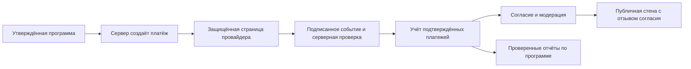

# «Сохрани вид»: демонстрация и будущая архитектура

Этап №9, 13 октября 2026 года. Приём пожертвований не открыт. Партнёр, бюджет,
платёжный провайдер и действующая программа финансирования не утверждены.
Ниже описан проект будущей системы; сервер и платёжные API не реализованы.

## Что работает сейчас

`SupportView` — отдельный раздел существующего Vue-приложения. Из научной карточки
передаётся только `speciesId`; запись находится в загруженном валидированном каталоге.
`SupportSpecies` использует `LessonPhoto` и `LessonReferences`: фото, автор, лицензия,
названия и ссылки не дублируются в новой научной базе. Угрозы и меры охраны показываются
лишь при наличии существующих `sourceIds` и источника, поддерживающего соответствующий
путь утверждения (`threats.0`, `conservationMeasures.0` и т. д.). Это техническая проверка
ссылок, а не независимая научная редактура; `verified` не меняется.

Кнопка научной карточки открывает существующее модальное окно и тот же интерактив
«Как исчезает вид». Декоративная CSS-мозаика служит визуальной связью; второго
Canvas-движка нет. Неизвестные численности не используются для обещаний результатов помощи.

`SupportWall` — локальный демонстрационный список, не публичная стена благотворителей.
Новая логика не делает сетевых запросов, не принимает платежи и не собирает контакты.
Пользователю предлагается выдуманный псевдоним и отдельное подтверждение понимания
демонстрации. Это подтверждение **не является согласием на будущую публичную публикацию**.

Формат в `localStorage`, единственный ключ `redbook.support.demo.v1`:

```json
{
  "version": 1,
  "entries": [
    {
      "id": "demo-example",
      "alias": "Друг гор",
      "speciesId": "irbis",
      "createdAt": "2026-10-13T00:00:00.000Z"
    }
  ]
}
```

Пример выше объясняет формат и не включается в приложение как готовая запись.
`speciesId: null` означает общую поддержку. Общая стена отображает все локальные записи
с их привязкой; переключатель выбранного вида показывает только его записи. Добавление
из общей стены создаёт общую запись, даже если научный вид выбран выше.

Ограничения: 50 записей, псевдоним 2–32 символа, Unicode-буквы/числа, пробел, дефис,
подчёркивание. NFC-нормализация; одинаковый псевдоним в одной области не дублируется.
Контактные строки, HTML, управляющие символы и длинные числовые последовательности
отклоняются. Проверяется также восстановленный JSON: версия, размер, поля, уникальность,
вид и ISO-дата. Псевдонимы выводятся обычной Vue-интерполяцией, без `v-html`.
Допустимые символы не позволяют установить, является ли строка реальным именем;
предупреждение пользователю остаётся необходимым. Подход к ограничениям ввода:
[OWASP Input Validation](https://cheatsheetseries.owasp.org/cheatsheets/Input_Validation_Cheat_Sheet.html).

Добавление, удаление и очистка сначала записываются в хранилище. Ошибка доступа/квоты
не выдаётся за успех. Некорректный список можно очистить. Удаляется только собственный
ключ: история викторины и остальные данные браузера сохраняются. Изменения другого
окна того же origin подхватываются через `storage` и перед каждой записью. Операции
localStorage не обеспечивают транзакционную защиту от строго одновременной записи двух
вкладок; этот список не подходит для финансового учёта. Данные доступны в данном профиле
браузера, включая другие вкладки того же сайта; синхронизации между пользователями нет.
Очистка данных браузера удаляет список. Демозаписи нельзя переносить в будущий реестр доноров.

## Условия будущего запуска

1. **Организация и программа.** Проверить регистрацию, полномочия представителя,
   банковского получателя, опыт и публичную отчётность партнёра. Согласовать договор,
   территорию, мероприятия, бюджет, сроки и измеримые результаты. Публиковать эти
   сведения до открытия поддержки. Научная запись вида остаётся отдельной сущностью:
   связь программы с видом не означает спасения отдельного животного или растения.
2. **Провайдер.** Проверить обслуживание организации в Кыргызстане, валюты, договор,
   комиссии, возвраты, поддержку и требования безопасности. Предпочтительная граница:
   ввод платёжных данных на защищённой странице провайдера; секреты только на сервере.
   Конкретный провайдер сейчас не выбран. Ссылка на Stripe ниже иллюстрирует обработку
   событий, а не подтверждает доступность его услуг для проекта.
3. **Серверное подтверждение.** Создать платёжное намерение на сервере, связав его с
   утверждённой программой и ожидаемыми параметрами. Переход браузера на страницу успеха
   не считать оплатой. Проверять статус через API провайдера, сумму, валюту и идентификатор
   назначения; учитывать возвраты и спорные операции. Рекомендации:
   [OWASP Payment Gateway Integration](https://cheatsheetseries.owasp.org/cheatsheets/Third_Party_Payment_Gateway_Integration_Cheat_Sheet.html).
4. **Webhook и учёт.** Проверять подпись уведомления по исходному телу запроса и правилам
   выбранного провайдера, включая защиту от повторного воспроизведения. Сохранять уникальные
   идентификаторы событий и платежей; повторная доставка не должна повторно учитывать
   поддержку. Обрабатывать события через надёжную очередь, не полагаясь на порядок
   доставки; сверять текущее состояние платежа. Предусмотреть повторные попытки и
   сверку с выписками. Пример первичной документации:
   [Stripe Webhooks](https://docs.stripe.com/webhooks). Не писать секреты и платёжные
   реквизиты в журналы.
5. **Добровольная публикация.** Оплата по умолчанию анонимна для посетителей стены.
   Отдельный необязательный opt-in объясняет публичность, выбранное отображаемое имя
   и привязку к программе. Хранить версию текста согласия, дату и состояние независимо
   от платежа. Отказ от публикации не препятствует поддержке. Не копировать имя из
   платёжных реквизитов автоматически; не публиковать email, сумму или идентификатор платежа.
6. **Модерация и отзыв.** Серверная валидация длины/символов, ограничение частоты запросов,
   безопасное текстовое отображение и очередь ручной модерации. Отклонять контакты,
   оскорбления и выдачу себя за организацию. Предоставить защищённый способ отзыва
   согласия, например отдельную непредсказуемую ссылку управления, без обязательной
   публичной учётной записи. После отзыва скрывать запись и удалять её из публичных
   кэшей; повторная публикация требует нового согласия. Внутренний финансовый учёт
   отделить от имени на стене; правила доступа и хранения определить до запуска.
7. **Отчётность.** Публиковать проверенные поступления, комиссии, возвраты, расходы,
   остатки и документы по конкретным программам с датами. Описывать фактические работы
   и ограничения оценки их эффекта. Источники отчётности — бухгалтерские документы
   и подтверждения партнёра, не локальная стена и не число пикселей на фотографии.

Предлагаемый поток для реального запуска:



Минимальные будущие сущности: `organization`, `program`, `payment`,
`publicationConsent`, `wallEntry`, `report`. Публичная стена читает только разрешённую
проекцию после подтверждения платежа, согласия и модерации. Возврат/спор не стирает
журнал событий; политика признания после возврата заранее описывается публично.
Платёжный учёт, научная база и публичное признание имеют разные права доступа.

Перед реальным запуском отдельно нужны правовая проверка условий, хранения данных
и отчётности для выбранной организации, проверка интеграции в sandbox провайдера,
тесты повторных/поддельных событий, возвратов, отзыва согласия и аудит безопасности.
Эти работы не выполнены в конкурсной демонстрации.
